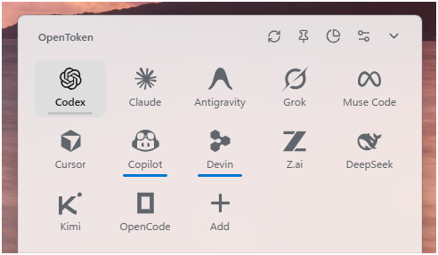

# OpenToken



**Your AI limits, a glance away.** A Windows notification-area app rebuilt in Rust and TypeScript from the behavior of QuotaTray. No .NET, Electron, web account, telemetry, or passwords to paste.

## Run

- [Build from source](#develop), or download the `OpenToken-windows-x64` build artifact from a successful [Windows CI run](https://github.com/valenciana-nc/OpenToken/actions/workflows/verify.yml) (GitHub sign-in required for CI artifact downloads).
- Portable output: `target/release/opentoken.exe` (also copied to `artifacts/OpenToken.exe` by the release script).
- Installer output: `target/release/bundle/nsis/OpenToken_1.0.0_x64-setup.exe` (per-user, no administrator privileges).
- Generated executables are not committed to the source repository.
- Builds are unsigned; Windows SmartScreen may warn.
- Requires Windows 10/11 x64 and Microsoft Edge WebView2. The installer offers WebView2 installation when needed.
- The dashboard docks **bottom-right** beside the system tray, above the taskbar. Settings → Dashboard position also offers bottom-left and beside-clicked-icon modes. Click an account's tray icon to open its dashboard. **The down-chevron and Escape hide it; they do not stop background updates.** Right-click → Exit stops the app intentionally.
- Windows controls whether notification icons appear in the overflow menu. Enable them in Taskbar Settings if necessary.

## Included

- A polished **single remaining-percentage badge** per verified account: smooth Fluent-blue progress ring, native Segoe UI typography and taskbar-aware light/dark surfaces. The provider-logo/stacked-percentage pair remains an option in Settings. Duplicate sign-in folders share an identity. Same email in different workspaces remains separate.
- Session, weekly, nonstandard-duration, Spark, credit and rate-limit-reset metrics. Claude supports session, weekly, model-specific and extra-usage metrics.
- Existing Codex homes are discovered in bounded, known locations; no drive-wide scans. `CODEX_HOME`, `.codex`, `.config/codex`, sibling Codex directories and bounded account/switcher subtrees are supported.
- **Discovery first, not login first**: use existing Codex/Claude/Cursor/GitHub/Grok/Devin sessions and the running Antigravity desktop server without launching authentication or creating another profile. Muse's read-only observation mode and separately confirmed subscription endpoint stay distinct. Native source inventory separates account quota, API balance and this-device client records. Official sign-in remains explicit account setup/recovery, not the tracking mechanism. See [source architecture and coverage](docs/SOURCE-ARCHITECTURE.md).
- Real Windows **acrylic glass** with native rounded corners, Segoe UI, translucent Fluent-style groups, blue remaining-quota bars and live reset countdowns. No copied desktop bars or dark side gutters. Light (default), dark and system themes; configurable bottom-left/bottom-right/tray-adjacent placement within the monitor work area.
- The dashboard and tray show **% left**; the API continues to report raw **percent used**. Six-dot account handles support drag-to-reorder and Space/Up/Down keyboard sorting; order survives restart without changing Windows tray order.
- **Live local tracking**: a Rust background watcher pushes recorded token/value updates even while the flyout is hidden. Fresh activity automatically advances verified quota reads, updating tray badges and mini bars without manual refresh; automatic active checks are budgeted to once a minute. Anonymous log percentages never get guessed onto the current identity. Settings retains an idle interval and Live tracking toggle. See [live tracking details](docs/USAGE.md#live-tracking).
- **Windows-style whole-popup slide**: the actual glass popup rolls upward from its dock and slides back down, with the fade retained—not just content moving inside a stationary box. Compositor-paced updates, immediate response and eased settling keep the layout fixed; quick reversals settle promptly, and Windows reduced-motion preferences are respected.
- **Unpinned by default**: clicking another app dismisses the popup. Pin it to keep it open and on top; your choice is remembered. The down-chevron always hides it without stopping tracking. Native folder dialogs and tray gestures are protected from accidental dismissal.
- A curated **12-provider logo grid**: Codex/Claude/Antigravity/Grok/Muse Code, then Cursor/Copilot/Devin/Z.ai/DeepSeek, then Kimi/OpenCode/**Add**, with no Overview tile. Codex/Claude retain quota and local-history views; **personal Cursor** reuses its desktop sign-in for explicitly labelled unofficial dashboard quotas; **Cursor Enterprise** adds selected-member usage/budget readings, and **Copilot** adds personal billing usage through official APIs. Z.ai/Kimi Code/OpenCode Go now have native key-scoped quota adapters and DeepSeek has an official API-balance adapter. Grok has native identity-bound private credit usage. **Antigravity** now reads owned local quota RPC, **Devin** reuses CLI or read-only desktop access to its private quota service, and **Muse** supports official last-observed subscription readings plus a separate, explicitly confirmed quota endpoint that can issue a CLI key. All twelve have native reader paths; this is not a claim of live entitlement, universal profile support or fresh Muse observations on every host. See [the detailed modes and safeguards](docs/REMAINING-PROVIDERS.md). Quota cards stay on the main page; history and spending have a separate Usage page.
- **One Providers & settings area** combines provider/account setup and app preferences. Add and provider-title shortcuts open the Providers section; the gear opens App settings. Unsaved drafts survive section/page navigation.
- The header's **Usage** pie-chart button opens the complete spending page, with All providers or a separate provider filter. It reads **local Codex/Claude/Grok/Kimi/Muse CLI usage records**, including subscription token usage, with side-by-side Today / Last 30 days token totals plus the full Today/Yesterday/30 Days donut and legend, cached-token pricing and duplicate suppression. Dollar values are clearly labelled **API-equivalent estimates, not subscription charges**. Reference rates are bundled; Settings supports explicit model-rate overrides. Partly priced totals show a dollar lower bound; entirely unpriced usage shows tokens instead of invented costs. Observed credit decreases/top-ups are tracked separately from token value. See [usage tracking](docs/USAGE.md).
- **Provider-specific readers** verify available access instead of treating sign-in as proof of quota. Personal Cursor, Copilot and Grok retain their private-source disclosures; Enterprise member usage/personal billing and regional API-key quotas remain distinct. Local history can be enabled/stopped separately, with retained imported totals and no inferred account identity. Unavailable sources never fabricate usage or request passwords. Muse's advanced key-issuing endpoint is not read-only: a default-No native warning is required, returned inference keys are discarded, CLI files are never rewritten, and background calls continue only for that saved mode until disconnected. Keys are verified before app-owned Windows Credential Manager persistence. No passwords, browser-cookie harvesting, guessed percentages or invoices. See [connection setup](docs/CONNECTIONS.md).
- Five-minute refresh by default, filesystem-triggered reconciliation, 60-second safety reconciliation, per-account backoff and bounded concurrency. Temporary failures are labelled as cached/unavailable **saved monitoring**, not disconnections. Grok/Copilot read-only HTTP observations get one bounded transient retry. Grok sign-in uses the official CLI's device-code flow; a separate default-No review can enable **official CLI session renewal** after rejection, rather than requiring another browser login at every token expiry. Read-only reuse never grants renewal. See [connection health](docs/CONNECTIONS.md#saved-monitoring-versus-current-usage-availability).
- Atomic settings/cache writes, backup settings recovery, explicitly stale readings and typed login errors. Unverified/changed Codex identities never inherit another identity's cache.
- Optional Windows startup through **one interactive Scheduled Task** with restart-on-failure, not a supervisor pair or perpetual one-minute process launcher.
- Read-only loopback JSON API on **127.0.0.1:6737**. Browser origins, browser fetch metadata and non-loopback Host headers are rejected. Refresh is through desktop IPC, not unauthenticated HTTP mutation.

## Accounts and credentials

Start with **Use existing** for subscription/session readers, or **Track local usage** where a recorded-client importer is available. These actions do not open login. Use **Account setup (only if needed)** for an additional account or explicit provider-owned authentication, and the advanced API forms only for their actual scopes. Existing configured/discovered accounts remain monitored. See [setup and scope](docs/CONNECTIONS.md). OpenToken asks the Codex CLI's `app-server` to read usage, isolating `CODEX_HOME` and clearing overriding API-token variables. Only if that fails and the sign-in is a consistent file-backed identity does it use an access-token-only HTTP fallback. **OpenToken never rotates Codex refresh tokens.** `keyring`/`auto` stores never fall back to a possibly stale `auth.json`; ephemeral logins cannot be monitored.

The JWT payload is decoded for consistency checks, **not cryptographically signature-verified**. Provider endpoints authenticate the actual token. Before/after checks prevent normal folder/account switches from putting another identity's usage on a card. If the CLI withholds a workspace ID for a credential-store login, its identity is conservatively scoped to that home rather than merged on email alone.

Claude renewal defaults off for new profiles; saved explicit choices survive. Existing-session connection never renews credentials. In the explicitly enabled legacy renewal path, OpenToken takes an advisory file lock, re-reads credentials, sends one refresh, checks for concurrent OAuth-field changes, and patches only token fields using an atomic write. **Claude Code is not guaranteed to honor OpenToken's lock.** This reduces lost writes but cannot eliminate cross-application refresh-token rotation races. Disable “Renew Claude tokens” if Claude Code should exclusively own renewal; OpenToken then asks you to reopen Claude on expiry. Custom OAuth servers/client-ID overrides are deliberately not supported: existing tokens are sent only to the fixed production HTTPS endpoints.

Credentials remain owned by the official CLIs. Explicit add-account recovery uses isolated `%LOCALAPPDATA%\OpenToken\sign-ins\{provider}\{opaque-id}` locations; existing CLI homes remain unchanged. The native Windows CLI sign-in launcher now supplies real console handles and clears nested/simple-mode overrides; the former pipe/null-handle defect is reproduced and documented in [the provider audit](docs/PROVIDER-RESEARCH.md). OpenToken's settings, quota cache, local counter index (`usage.sqlite3`, with SQLite WAL/SHM files) and logs live in `%LOCALAPPDATA%\OpenToken`. Usage caches/API responses can contain account emails and folder paths, but never tokens. Other processes running as your user can read the unauthenticated native-client API; disable it if you do not need it.

## Startup and recovery

Enable **Settings → Launch with Windows** in a release build. This registers a limited, interactive `OpenToken` Scheduled Task with a logon trigger and up to 10 one-minute restart attempts after failures. There is no Run key, Startup shortcut or repeating trigger. A scheduled instance returns nonzero on fatal errors and zero on intentional Exit. Explorer-restarter handling comes from the native tray library.

A manually started instance is **not retroactively owned by Task Scheduler**. Enabling startup takes full recovery effect from the next sign-in, or after exiting and running the task yourself with `schtasks /Run /TN OpenToken`. Hung-but-alive processes are not detected by this policy. Development builds and `--no-startup` never register tasks. Uninstall removes only OpenToken's task and leaves user data intact.

## API and commands

```powershell
curl.exe http://127.0.0.1:6737/health
curl.exe http://127.0.0.1:6737/v1/state
curl.exe http://127.0.0.1:6737/v1/accounts
curl.exe http://127.0.0.1:6737/v1/usage/codex
.\OpenToken.exe show
.\OpenToken.exe settings
.\OpenToken.exe refresh
.\OpenToken.exe quit
.\OpenToken.exe --doctor
.\OpenToken.exe --background --no-startup
```

`/v1/usage` aliases `/v1/state`; `/v1/usage/{account-id}` selects one account. These are new typed OpenToken schemas, not drop-in QuotaTray response schemas. `ETag` / `If-None-Match` supports 304 responses. API port/enabled changes apply immediately. CLI `settings` targets an already-running app; normal first launch opens the provider dashboard. `--doctor` prints local paths/tool availability (no tokens), not a live quota read. GUI-subsystem console output may need redirection in PowerShell.

## Develop

Prerequisites: Node 24+, Rust stable (MSVC), Visual Studio C++ Build Tools + Windows SDK, WebView2. On this machine a user-local toolchain is detected by `scripts/windows-env.ps1`; a normal Visual Studio Developer PowerShell also works.

```powershell
npm ci
.\scripts\dev.ps1
# In a configured developer shell:
cargo fmt --all --check
cargo clippy --workspace --all-targets -- -D warnings
cargo test --workspace
npm run check
npm run test:e2e
.\scripts\build-release.ps1
# Optional real native/WebView smoke, using separate synthetic instance IDs, sign-ins and test ports:
# The live default portable can stay running; fixtures cannot forward quit into it.
cargo build -p opentoken --example focus-target
node scripts/native-smoke.mjs
```

`npm run dev` is browser-only and does not expose credentials or talk to the API. Add `?demo` for an explicitly labelled design preview with sample data. Browser tests use installed Microsoft Edge. Native smoke uses a test-only native Rust window to verify real focus changes, clicks only its synthetic windows, and restores the pointer. Run it in an interactive desktop; keep the live default OpenToken instance running. Tests use isolated source homes, instance IDs, provider processes and ports, and must never stop production. It temporarily enables localhost WebView debugging in the **test child only**; the shipped app does not enable a debugging port.

## Architecture and migration

See [ARCHITECTURE](docs/ARCHITECTURE.md), [SECURITY](docs/SECURITY.md), [PROTOCOLS](docs/PROTOCOLS.md), [installed-client compatibility findings and real-source acceptance](docs/COMPATIBILITY-2026-10-19.md), [session-source and explicit owner recovery](docs/SESSION-RECOVERY-2026-10-19.md), [Antigravity CLI-profile integration and repository comparison](docs/ANTIGRAVITY-RESEARCH-2026-10-19.md), and [verification](docs/VERIFICATION.md).

Settings → Import QuotaTray reads provider/discovery preferences and configured/ignored folders into the unsaved form; review and save. It does **not** copy tokens, stop QuotaTray, change its settings or remove its startup entries. Disable QuotaTray yourself when ready to cut over. Different API ports allow comparison side by side. Concurrent Claude renewal by two monitoring applications adds rotation risk; disable it in one during comparison.

Reference UI provider marks are bundled from pinned CodexBar vectors (MIT); native tray marks use Simple Icons 13.21.0 (CC0); see [third-party notices](docs/THIRD-PARTY.md). Independent software, not affiliated with OpenAI or Anthropic. Undocumented provider protocols can change. MIT-licensed; behavior informed by QuotaTray and [OpenUsage](https://github.com/robinebers/openusage), with attribution retained in [LICENSE](LICENSE).
